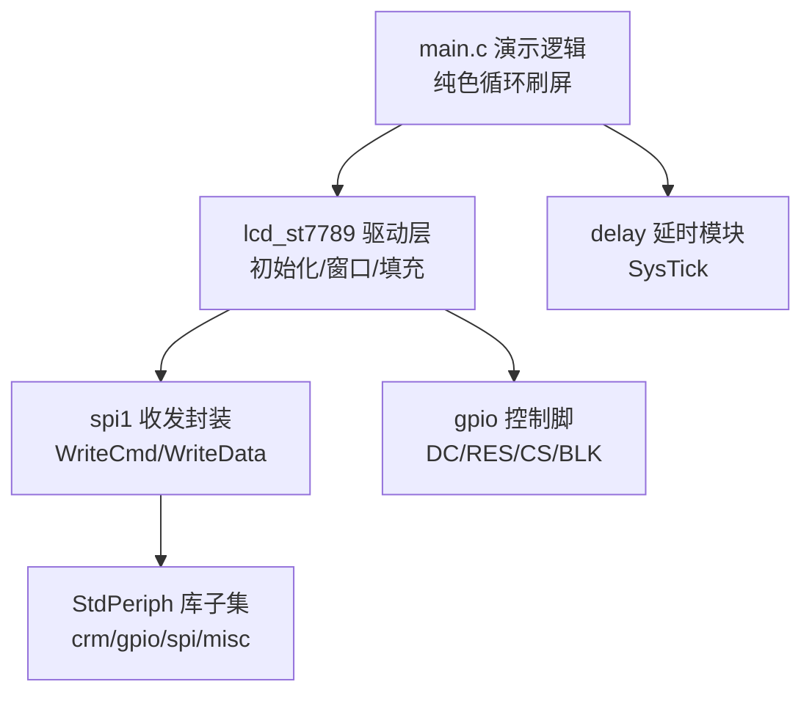

## 产品概述

为 AT32F403ACGU7 主控搭建一个基于 Keil5 (MDK5) 的 ST7789V 屏幕演示工程，从零生成完整可编译烧录的交付物：.uvprojx 工程文件 + 启动文件 + 雅特力官方固件库（最小子集）+ LCD 驱动源码 + 演示主程序。

## 核心功能

- **硬件 SPI1 驱动 ST7789V**（240×240 分辨率）：SCL=PA5（SPI1_SCK）、SDA=PA7（SPI1_MOSI）、DC=PA4、RES=PA6、CS=PB0、BLK(背光)=PB1
- **LCD 驱动层**：复位时序、ST7789V 初始化序列（含 240x240 偏移与反色处理）、写命令/数据、设置显示窗口、全屏清色、区域填充、背光开关
- **演示效果**：上电初始化后开背光，循环全屏刷 红→绿→蓝→白→黑→黄→青→洋红，每种颜色停留可见间隔，直观检验坏点与刷新率
- **完整 Keil5 工程**：双击 .uvprojx 即可打开，编译生成 HEX，配合 CMSIS-DAP/JLink 等调试器烧录运行

## 补充说明

- SPI 配置：主机模式、8bit、MSB 先行、CPOL=High/CPHA=2Edge（Mode 3），分频取较高时钟以提升刷屏流畅度
- 延时采用 SysTick 实现毫秒级复位与演示间隔延时
- 全部代码注释使用简体中文（遵循 [skill:chinese-comments-logging] 规范）

## 技术栈

- 主控：AT32F403ACGU7（Artery，Cortex-M4，最高 240MHz）
- 开发环境：Keil MDK5 (ARM Compiler 6)，设备包 Artery.AT32F403A_4xx_DFP
- 固件库：AT32F403A_4xx StdPeriph（雅特力官方风格 API：crm/gpio/spi/misc）
- 通信：硬件 SPI1（仅 TX 方向，MISO 不接）
- 显示驱动：ST7789V，16bit RGB565，SPI 写命令 + DC 引脚区分命令/数据

## 实现方案

### 总体策略

工作区为空目录，需从零生成全部文件。为避免依赖外部下载，**手工编写与官方库 API 兼容的最小固件库子集**（仅包含本工程所需外设：CRM(RCC)、GPIO、SPI、misc + CMSIS 内核头 + 系统初始化 + 启动文件），保证工程开箱即编译。若执行环境可联网，可优先从 Artery 官方 GitHub 拉取 AT32F403A_4xx_Firmware_Library 替换，API 完全一致。

### 关键技术决策

1. **硬件 SPI1 而非模拟 SPI**：PA5/PA7 恰为 SPI1_SCK/SPI1_MOSI，硬件收发单字节开销远小于 GPIO 翻转，全屏 240×240×16bit = 115200 字节可高速刷完，肉眼可见流畅刷新
2. **刷屏优化**：设置窗口后循环发送像素时，仅首字节需检查 TXE 并等待，后续字节用“写 DR 前等待 BSY/TXE”的流水方式；不使用 DMA 的中断逐字节方案（KISS），代码简单且已够快
3. **启动文件**：startup_at32f403a_4xx.s 采用标准 MDK 汇编启动模板（Stack/Heap 定义、向量表、Reset_Handler → SystemInit → __main），工程文件指向 Artery DFP 器件
4. **ST7789V 240x240 兼容**：初始化序列参考数据手册通用配置（SLPOUT→PORCTRL/GCTRL/VCOMS/FRCTRL/PWCTRL1→MADCTL→COLMOD=16bit→INVON→CASET/RASET→DISPON→NORON），并提供可调的 X/Y 偏移宏以适配不同模组偏移
5. **SysTick 延时**：基于 1ms 中断计数的非侵入式 delay_ms，复位时序（RES 拉低≥10ms）与演示间隔均依赖它

### 性能与可靠性

- 全屏填充复杂度 O(240×240)，瓶颈在 SPI 字节流速度：SPI1 时钟按 PCLK2 最高分频比取尽量高频率（几十 MHz 级），单字节等待开销通过“先写后等”流水化摊薄
- 复位/初始化时序留足裕量（复位后 delay 120ms 再发指令），避免上电时序不稳
- 错误防护：所有窗口坐标做范围裁剪，防止 CASET/RASET 越界

## 架构设计

分层结构（依赖单向向下）：



## 目录结构

```
h:/Projects/AT32F403ACGU7/
├── Project/
│   └── AT32F403A_LCD_Demo.uvprojx   # [NEW] MDK5 工程文件：Device=AT32F403ACGU7，AC6 编译器，C99，
│                                    #   Include 路径与宏定义（AT32F403ACGU7? 以库头文件为准的型号宏 + USE_STDPERIPH_DRIVER），
│                                    #   分组 User/Drivers/Libraries，生成 HEX，调试器默认 CMSIS-DAP
├── User/
│   ├── main.c                       # [NEW] 演示入口：系统时钟与 SysTick 初始化 → LCD_Init → 开背光 →
│   │                                #   while 循环红/绿/蓝/白/黑/黄/青/洋红全屏刷色，各 500ms 间隔
│   ├── at32f403a_4xx_it.c           # [NEW] 中断服务：SysTick_Handler 维护毫秒计数；其余保持默认空实现
│   └── at32f403a_4xx_conf.h         # [NEW] 外设包含配置头（gpio/spi/crm/misc）
├── Drivers/
│   ├── lcd_st7789.h                 # [NEW] 驱动接口：LCD_Init、LCD_WriteCmd/WriteData8/16、
│   │                                #   LCD_SetWindow、LCD_Clear、LCD_Fill、LCD_SetBacklight，颜色宏(RGB565)
│   └── lcd_st7789.c                 # [NEW] 驱动实现：GPIO+SPI1 初始化、复位时序、ST7789V 初始化序列、
│                                    #   窗口设置、全屏/区域填充（流水式 SPI 发送）
├── Libraries/
│   ├── CMSIS/
│   │   ├── core_cm4.h / cmsis 相关内核头  # [NEW] ARM CMSIS 内核头文件
│   │   ├── at32f403a_4xx.h          # [NEW] 器件寄存器定义与位掩码（按官方风格命名，本工程所需外设）
│   │   ├── system_at32f403a_4xx.h   # [NEW] SystemInit/SystemCoreClock 声明
│   │   └── system_at32f403a_4xx.c   # [NEW] 系统时钟初始化（HICK+PLL 至默认主频，Flash 等待周期）
│   └── Drivers/
│       ├── at32f403a_4xx_crm.c/.h   # [NEW] 时钟管理（官方 API 风格：crm_periph_clock_enable 等）
│       ├── at32f403a_4xx_gpio.c/.h  # [NEW] GPIO 配置（gpio_init/gpio_mode_set 等官方 API 风格）
│       ├── at32f403a_4xx_spi.c/.h   # [NEW] SPI 配置与收发（spi_init/spi_i2s... 仅用到的 API）
│       └── at32f403a_4xx_misc.c/.h  # [NEW] 中断优先级分组配置（nvic 初始化）
├── MDK/
│   └── startup_at32f403a_4xx.s      # [NEW] MDK 汇编启动文件：栈/堆定义、向量表、Reset_Handler
└── README.md                        # [NEW] 使用说明：Keil 打开步骤、依赖设备包、编译烧录、引脚连接表、
                                     #   常见问题（屏幕偏移/反色调整、背光极性、SPI 时钟调整）
```

## 关键代码结构

LCD 驱动核心接口（多模块依赖，需精确定义）：

```c
/* lcd_st7789.h */
#define LCD_W 240
#define LCD_H 240
/* 可按模组调整的偏移：多数 240x240 ST7789V 模组 Y 起始偏移 80 */
#define LCD_X_OFFSET 0
#define LCD_Y_OFFSET 80

void LCD_Init(void);                       /* GPIO+SPI1 初始化、复位时序、寄存器初始化序列 */
void LCD_WriteCmd(uint8_t cmd);             /* DC=0，发命令字节 */
void LCD_WriteData8(uint8_t data);          /* DC=1，发单字节数据 */
void LCD_WriteData16(uint16_t data);        /* DC=1，发 16bit 像素（高字节在前） */
void LCD_SetWindow(uint16_t x1, uint16_t y1, uint16_t x2, uint16_t y2); /* CASET/RASET，坐标加偏移 */
void LCD_Clear(uint16_t color);             /* 全屏填充单色 */
void LCD_Fill(uint16_t x1, uint16_t y1, uint16_t x2, uint16_t y2, uint16_t color);
void LCD_SetBacklight(uint8_t on);          /* BLK(PB1) 控制背光 */
```

## 实现要点

- SPI1 发送采用“等 TXE → 写 DR”逐字节发送，窗口设置后整屏填充前仅需一次 SetWindow；CS 在整次刷新期间保持拉低，避免逐字节拉高引入开销
- RES=PA6 与 SPI1_MISO 复用：本工程配置 PA6 为普通推挽输出，SPI 仅用 TX（不使能 MISO GPIO 复用），无冲突
- 背光默认高电平点亮；若实际模组低有效，README 指出修改点（一处宏）
- 注释与打印信息全部使用简体中文，不引入额外日志机制（裸机无操作系统，保持精简）
- 工程兼容性：不改动任何既有内容（工作区为空），全部为新建文件，影响范围可控

## Agent Extensions

### Skill

- **chinese-comments-logging**
- 用途：为新建的所有 C 源文件（固件库子集、LCD 驱动、main.c、中断服务）编写统一风格的简体中文注释，包括文件头说明、函数功能注释与关键时序说明
- 预期成果：全部源码注释为简体中文，风格一致，关键初始化时序和引脚映射有清晰中文说明