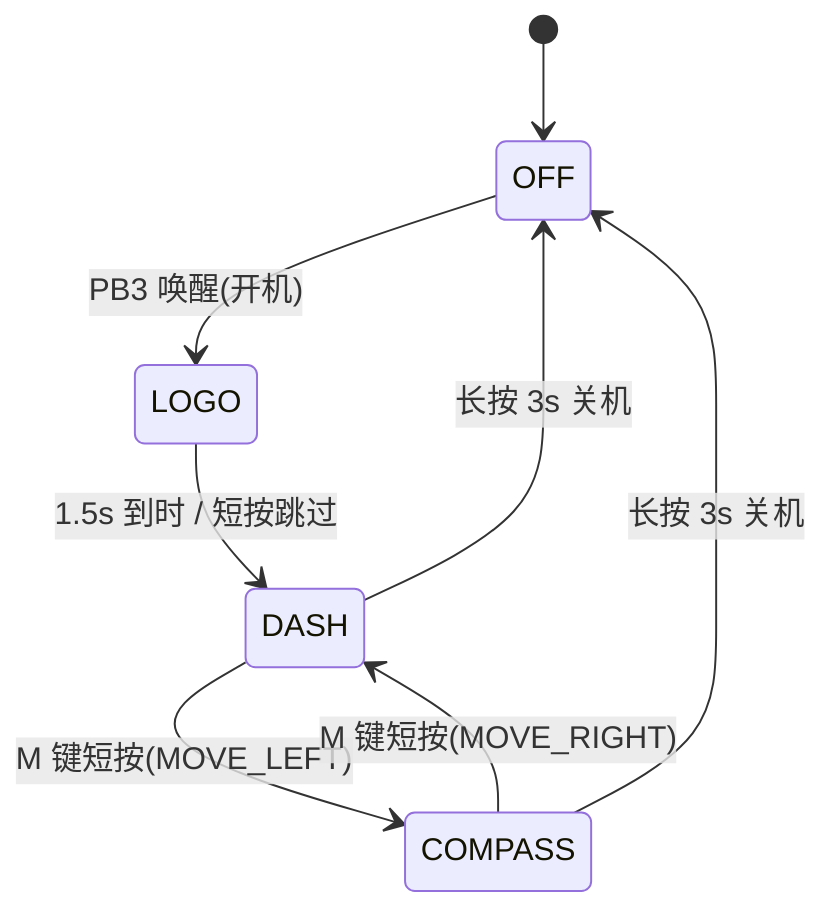

## 用户需求

为本固件增加应用层状态机与按键事件解耦机制：

## 产品概述

设备上电默认处于关机（空）状态，按下按键唤醒开机，先展示开机 LOGO 页面，随后自动进入骑行仪表盘页面；在骑行页面按 M 键切换到指南针页面，再按 M 键循环切回骑行页面；长按 3 秒执行关机序列，回到关机状态等待下次唤醒。

## 核心功能

- **状态机流程**：空状态（停机）→ 按键按下开机 → 开机 LOGO（约 1.5s 自动跳转，短按可跳过）→ 骑行仪表盘 → 按 M 键切换指南针（多页面固定顺序循环，未来可扩展更多页面）。
- **按键分层解耦**：按键扫描保留在底层驱动（现有 TMR7 1ms 消抖采样），应用层不直接解析按键电平；每个状态在状态机中注册对应的按键触发函数指针（短按/长按事件入口），按键语义随状态变化。
- **状态内页面加载**：状态跳转时对应 UI 页面的加载/切换动画（滑动过场）全部在状态机的进入/退出回调中实现，页面创建与数据刷新逻辑保持在 UI 模块内。
- **M 键载体**：复用现有编码器 PUSH 按键，短按为 M 键，长按 3s 仍为关机；旋转编码器调背光行为不变。
- **真实关机**：上电默认进入停机（DEEPSLEEP）状态，按键唤醒开机后重走完整开机流程（LOGO→仪表盘），而非原地恢复旧界面。

## 技术栈

- 现有技术栈：AT32F403ACGU7 + FreeRTOS v202212.01 + LVGL v8.3 + Keil MDK5 (AC6)，纯 C 开发，不引入新技术。
- 复用现有机制：TMR7 按键扫描驱动（`driver_encoder`）、FreeRTOS 队列跨线程通信、`lv_scr_load_anim` 页面切换、`lowpower_power_down()` 停机唤醒机制。

## 实现方案

### 核心思路

在 Application 层新增状态机模块 `app_state.c/h`（用户指定命名），采用**状态表驱动**设计：每个状态注册 `on_enter`（页面加载）/ `on_exit`（退出清理）/ `key_handler`（按键触发函数指针）三个回调。底层按键扫描（`driver_encoder` 的 TMR7 ISR + 20ms 轮询任务）保持不变，按键事件经 `g_encoder_queue` 送入 LVGL 任务后由状态机分发——满足"底层扫描与应用层分离、按状态注册按键函数指针"的要求；页面加载收拢到状态的 `on_enter` 中——满足需求 3。

### 状态与跳转



- `SM_STATE_OFF`：关机态（真实停机，由 `encoder_task` 执行 `lowpower_power_down()`，非 LVGL 上下文）；状态机仅记录该状态。
- `SM_STATE_POWER_ON`：过渡态（收到唤醒事件，初始化计时器后立即转 LOGO）。
- `SM_STATE_LOGO`：LOGO 页，`on_enter` 记录 `xTaskGetTickCount()` 起始时刻；`app_state_tick()` 差值达 `SM_LOGO_DURATION_MS`(1500) 自动跳转；短按跳过。
- `SM_STATE_DASH` / `SM_STATE_COMPASS`：M 键循环切换，沿用现有 `LV_SCR_LOAD_ANIM_MOVE_LEFT/RIGHT, 250ms, auto_del=FALSE`（双 screen 常驻，切换动画与现状一致）。

### 关键决策

1. **状态机运行在 lvgl_task 上下文**：LVGL 非线程安全，所有 UI/LVGL 调用（页面加载、切页动画）必须收敛在 LVGL 任务；按键事件由 `lvgl_task` 从队列取出后转发 `app_state_key_event()`，`app_state_tick()` 在每周期 `lv_timer_handler()` 前调用。**停机序列保留在 `encoder_task`**（阻塞等松手，不能阻塞 LVGL 任务），关机后向队列投递 `wakeup=1` 开机事件，唤醒后状态机重走 LOGO 流程（替代现状的"原地恢复"）。
2. **队列消息扩展而非新建队列**：在 `app_encoder_msg_t`（app_main.h）新增 `int32_t wakeup` 字段（保持统一 int32 宽度规范），`encoder_task` 唤醒后置 1 投递；`lvgl_task` 收到后调用 `app_state_wakeup()`。避免新增任务/队列的开销。
3. **按键事件语义抽象**：状态机入口将底层事件（push_pressed/hold_ms）解析为 `KEY_EVENT_SHORT_PRESS` / `KEY_EVENT_LONG_PRESS` / `KEY_EVENT_HOLD_PROGRESS` 三类，各状态的 `key_handler` 只关心语义事件——长按关机进度提示（`s_power_label`）由状态机统一调用现有 `app_ui` 接口处理，各页面行为一致。
4. **页面创建/切换分离**：`app_ui.c` 拆出 `app_ui_page_create()`（LOGO/DASH/COMPASS 三页创建，main 初始化时调用）与 `app_ui_page_show()`（指定页面 + 切换方向动画），由状态机 `on_enter` 调用；`app_ui_encoder_event()` 中的短按切页逻辑（s_btn_state 翻转 + lv_scr_load_anim）删除，旋转调背光逻辑保留原路径（不属于状态跳转，属持续交互）。
5. **LOGO 页零资源方案**：LVGL 标签（montserrat_28 品牌字样）+ 简单图形，约 1.5s，不占 Flash 大资源；上电默认加载 LOGO 页。
6. **向后兼容控制**：`s_btn`（顶层切换按钮）、`s_power_label`（关机提示）、传感器刷新函数、引脚自检行全部保留不动；`s_btn_refresh` 由状态机切页时调用以同步按钮外观。

### 架构分层（保持现有单向依赖）

- Application：`app_state`（新，编排层）→ `app_ui`（页面/控件层）
- Middleware：LVGL / FreeRTOS（不变）
- Drivers：`driver_encoder`（按键扫描，不变）/ `driver_lowpower`（停机，不变）

### 目录结构（Software/APP/ 下）

```
Software/APP/
├── Application/
│   ├── app_state.c          # [NEW] 状态机(用户指定命名): 状态表(枚举+ops 结构体数组), 各状态 on_enter/on_exit/key_handler
│   │                        #       回调实现(LOGO 计时跳转/多页循环/长按关机), 对外 API:
│   │                        #       app_state_init/app_state_key_event/app_state_wakeup/app_state_tick
│   ├── app_state.h          # [NEW] 状态机接口: 状态/按键事件枚举, 状态 ops 结构体定义, API 声明
│   ├── app_ui.c             # [MODIFY] 拆出 app_ui_page_create/app_ui_page_show;
│   │                        #         新增 LOGO 页创建(标签+简单图形);
│   │                        #         app_ui_encoder_event 删除短按切页逻辑(保留旋转调背光);
│   │                        #         新增关机提示控制接口供状态机调用
│   ├── app_ui.h             # [MODIFY] 新增页面枚举与 page_create/page_show/关机提示接口声明
│   ├── app_main.c           # [MODIFY] 恢复 lowpower_init/lowpower_boot_wait(Step1.1);
│   │                        #         app_ui_init 改为 app_ui_page_create;
│   │                        #         encoder_task 唤醒后投递 wakeup 开机事件(删除"原地恢复"消息);
│   │                        #         lvgl_task 按键事件转发 app_state_key_event, 周期调用 app_state_tick;
│   │                        #         main 中调用 app_state_init()
│   └── app_main.h           # [MODIFY] app_encoder_msg_t 新增 int32_t wakeup 字段(统一 32 位)
└── Project/
    └── AT32F403A_LCD_Demo.uvprojx  # [MODIFY] Application 编组新增 app_state.c
```

### 关键代码结构

```c
/* app_state.h —— 状态与按键事件枚举 + 状态表结构 */
typedef enum
{
  SM_STATE_OFF = 0,       /* 空状态: 停机关机态 */
  SM_STATE_POWER_ON,      /* 按键按下开机过渡态 */
  SM_STATE_LOGO,          /* 开机 LOGO 态 */
  SM_STATE_DASH,          /* 骑行仪表盘态 */
  SM_STATE_COMPASS,       /* 指南针态 */
  SM_STATE_NUM
} app_state_id_t;

typedef enum
{
  KEY_EVENT_SHORT_PRESS = 0,   /* 短按沿(按下沿) */
  KEY_EVENT_LONG_PRESS,        /* 长按达 3s 阈值 */
  KEY_EVENT_HOLD_PROGRESS      /* 长按保持中(hold_ms 携带进度) */
} app_state_key_event_t;

/* 状态表: 每状态注册进入/退出/按键触发函数指针 */
typedef struct
{
  void (*on_enter)(void);                                            /* 状态进入: 加载对应 UI 页面 */
  void (*on_exit)(void);                                             /* 状态退出: 清理/复位计时 */
  void (*key_handler)(app_state_key_event_t evt, uint32_t hold_ms);  /* 本状态按键触发函数指针 */
} app_state_ops_t;

void app_state_init(void);                                                /* 注册状态表, 初始态=SM_STATE_LOGO */
void app_state_key_event(app_state_key_event_t evt, uint32_t hold_ms);    /* 按键语义事件分发(仅 LVGL 任务) */
void app_state_wakeup(void);                                              /* 停机唤醒开机事件 -> POWER_ON -> LOGO */
void app_state_tick(void);                                                /* 周期调用: LOGO 到时自动跳转(仅 LVGL 任务) */
```

## 实施要点

- **线程安全**：状态机全部 API 仅在 `lvgl_task` 调用；`encoder_task` 只投递队列消息，不碰状态机内部状态。
- **唤醒路径**：`lowpower_boot_wait()` 在 `main()` 调度器启动前返回（首次开机），状态机初始态设为 LOGO 即覆盖首次开机；停机唤醒走队列 `wakeup` 事件路径。注意 `lowpower_init/boot_wait` 恢复后上电默认停机，调试期可临时注释（保持注释行不删除）。
- **长按防误触发**：唤醒沿与短按沿共用 PB3 下降沿，唤醒后的首个 `push_pressed` 事件须被状态机吞掉（POWER_ON 态的 key_handler 忽略首次短按），避免"按一下开机直接跳过 LOGO"。
- **性能**：状态机为 O(1) 表查找，无动态内存；LOGO 页复用 LVGL 32KB TLSF 堆，页面常驻不反复创建销毁（与现有双 screen 模式一致）。
- **注释规范**：所有新增/修改代码遵循工程中文函数头注释规范（函 数 名/入口参数/出口参数/返回 值/函数功能/修改历史 + Step 注释），使用 [skill:HMI Code Commenter] 保证一致性。
- **构建验证**：将 `app_state.c` 加入 uvprojx 的 Application 编组后，命令行 `C:\Keil_v5\UV4\UV4.exe -b Software\APP\Project\AT32F403A_LCD_Demo.uvprojx -j0 -o build_log.txt`，检查日志 `0 Error(s)`；clangd 诊断经仓库根 `compile_flags.txt` 自动生效（Application 路径已包含）。
- **回退控制**：改动集中在 Application 层三个文件 + 一个新文件，不动 Drivers/Middleware/LVGL 配置，不改分区与链接基址。

## Agent Extensions

### Skill

- **HMI Code Commenter**
- 用途：新增 `app_state.c/h` 及修改 `app_ui.c`/`app_main.c` 时，强制遵循工程中文函数头注释规范（函 数 名/入口参数/出口参数/返回 值/函数功能/修改历史、Step1/Step2 行内步骤注释、控制流强制大括号）。
- 预期成果：新状态机模块与被修改函数的注释风格与既有代码完全一致，含修改历史记录条目。